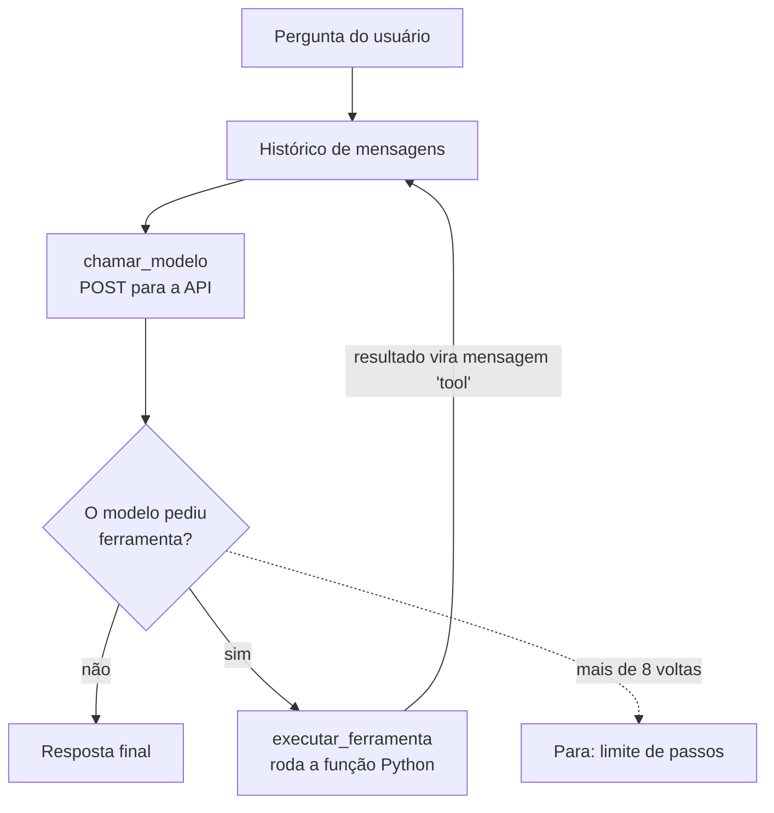

# Agente nível 1

Um agente de IA em Python **sem framework** e **sem dependências**: só a biblioteca
padrão e uma API gratuita de LLM (Groq por padrão). O objetivo é entender o mecanismo
que os frameworks (LangGraph, Pydantic AI, CrewAI...) escondem.

## O que é um agente, nesta implementação

Um LLM sozinho só gera texto: não sabe a data de hoje, erra contas e não acessa a
internet. O agente dá ao modelo **ferramentas**, que são funções Python comuns. O modelo
não executa nada: ele só **pede** uma ferramenta, com argumentos, e o nosso código
executa e devolve o resultado. Isso se repete até o modelo ter informação suficiente
para responder.



## Como rodar

```bash
# 1. Crie uma chave gratuita em https://console.groq.com/keys
export GROQ_API_KEY="gsk_..."

# 2. Rode
python agente.py
```

Outros provedores (todos usam o formato de API da OpenAI, então só mudam URL, chave e modelo):

```bash
PROVEDOR=gemini GEMINI_API_KEY="..." python agente.py
PROVEDOR=ollama python agente.py          # local, precisa do Ollama rodando
MODELO=outro-modelo python agente.py      # sobrescreve o modelo padrão
```

## Estrutura do código

| Seção | O que faz | Principais nomes |
|---|---|---|
| 1. Configuração | Escolhe provedor, modelo e limite de passos | `PROVEDORES`, `MAX_PASSOS` |
| 2. Ferramentas | Funções que o modelo pode pedir e a descrição delas | `FERRAMENTAS`, `ESQUEMA_FERRAMENTAS`, `PROMPT_SISTEMA` |
| 3. Chamada ao modelo | POST HTTP e execução segura das ferramentas | `chamar_modelo`, `executar_ferramenta` |
| 4. Loop do agente | Repete "pede → executa" até a resposta final | `rodar_agente` |
| 5. Terminal | Chat interativo e tratamento de erros | `main` |

### Ferramentas disponíveis

| Ferramenta | Para que serve | Exemplo de resultado |
|---|---|---|
| `calcular(expressao)` | Contas aritméticas, sem `eval` | `"16.666666666666668"` |
| `data_hora_atual()` | Data e hora locais em ISO | `"2026-11-10 00:10 (formato ano-mês-dia), terça-feira"` |
| `dias_entre_datas(data_inicial, data_final)` | Diferença em dias entre datas AAAA-MM-DD | `"45 dias de 2026-11-10 até 2026-12-25"` |
| `buscar_wikipedia(termo)` | Resumo de um artigo da Wikipédia em português | `"Natal: O Natal é ..."` |

## Exemplo: o histórico de uma pergunta

A API não guarda estado. A cada volta do loop, o histórico **inteiro** é enviado.
Para "quantos dias faltam para o natal?", ele cresce assim:

```text
system     → regras do agente (PROMPT_SISTEMA)
user       → "quantos dias faltam para o natal?"
assistant  → pede data_hora_atual()                                   ← volta 1
tool       → "2026-11-10 00:10 (formato ano-mês-dia), terça-feira"
assistant  → pede dias_entre_datas("2026-11-10", "2026-12-25")        ← volta 2
tool       → "45 dias de 2026-11-10 até 2026-12-25"
assistant  → "Faltam 45 dias para o Natal."                            ← volta 3: resposta final
```

Cada mensagem `tool` carrega o `tool_call_id` do pedido correspondente, para o modelo
saber qual resultado é de qual pedido quando ele chama várias ferramentas de uma vez.

## Como adicionar uma ferramenta

1. Escreva a função em `agente.py`, recebendo strings e devolvendo uma string.
2. Registre em `FERRAMENTAS`: `"minha_ferramenta": minha_ferramenta`.
3. Descreva em `ESQUEMA_FERRAMENTAS`. O modelo **só lê essa descrição**, não o código.
   Diga *quando* usar a ferramenta e o formato exato de cada argumento.

## Decisões de projeto

- **Erros de ferramenta voltam para o modelo** como texto `"ERRO ..."`, em vez de
  derrubar o programa. Assim ele pode tentar de outro jeito ou avisar o usuário.
- **`calcular` não usa `eval`**: o texto vem do modelo, e `eval` executaria qualquer
  código Python. A expressão é analisada como árvore (AST) e só números e operadores
  aritméticos são aceitos.
- **Datas sempre em ISO (AAAA-MM-DD)**: `10/11/2026` foi lido pelo modelo como
  11 de outubro (ver v0.3 no [CHANGELOG](CHANGELOG.md)).
- **Limite de 8 passos** por pergunta, para um modelo que pede ferramentas sem parar
  não travar o programa nem gastar a cota gratuita.
- **Histórico restaurado em caso de falha** de rede/API, para não deixar pedidos
  de ferramenta sem resultado no histórico.

## Limitações conhecidas

- O modelo pode ignorar as instruções do prompt. Nada no código *garante* que ele
  use as ferramentas; isso só se resolve com validação no código e testes.
- O histórico cresce sem limite durante a sessão e é perdido ao sair.
- Planos gratuitos têm limite de requisições (erro 429 quando estoura).

## Erros comuns

| Erro | Causa provável |
|---|---|
| `Defina a variável de ambiente GROQ_API_KEY` | Faltou o `export` neste terminal |
| `Erro 401` | Chave inválida ou copiada errada |
| `Erro 403 ... 1010` | User-Agent bloqueado pelo Cloudflare (corrigido na v0.2) |
| `Erro 404` / modelo não encontrado | Nome do modelo mudou; use `MODELO=...` com o nome atual do console |
| `Erro 429` | Limite do plano gratuito; espere ou troque de provedor |

Histórico de versões e bugs corrigidos: [CHANGELOG.md](CHANGELOG.md).